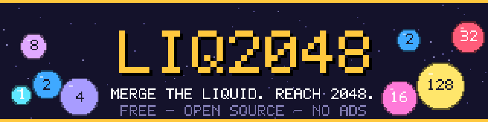
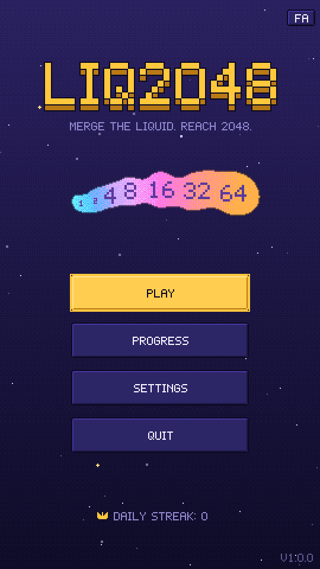
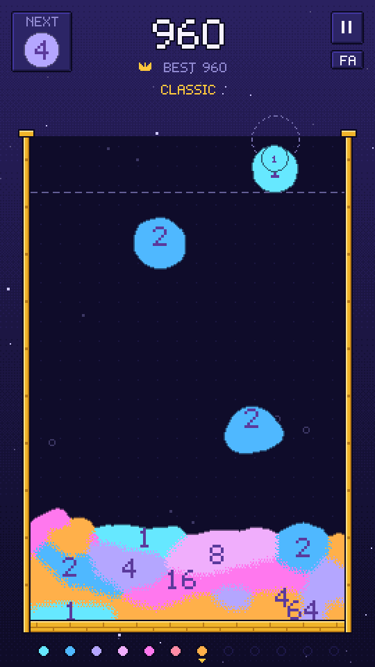
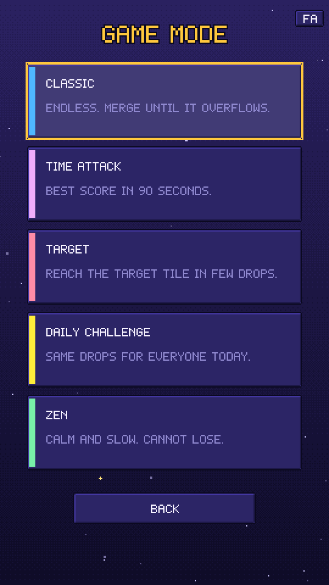
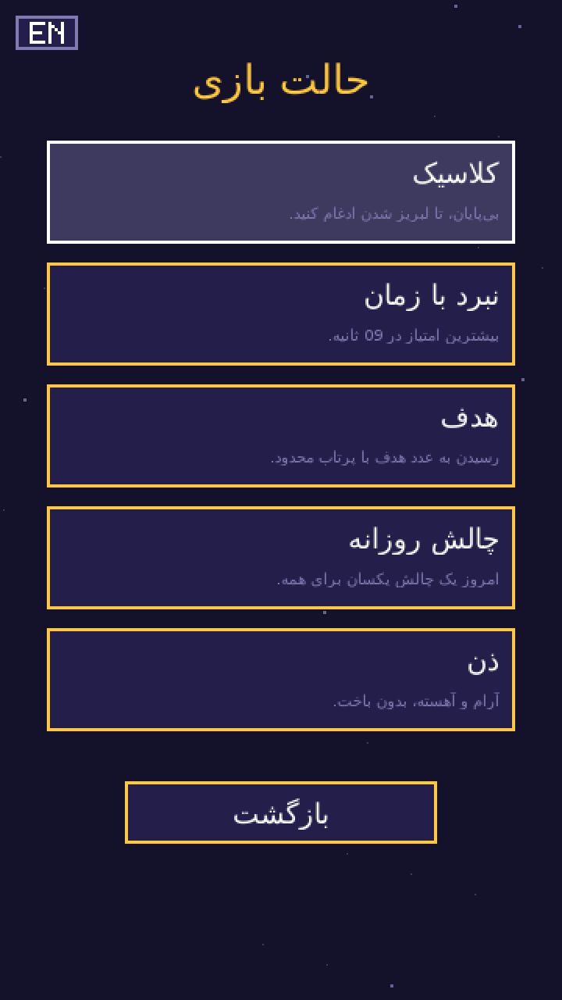

<p align="center">
  
</p>

<p align="center">
  <a href="https://github.com/sobhanmohammadi-dev/Liq2048/actions/workflows/ci.yml"></a>
  <a href="https://github.com/sobhanmohammadi-dev/Liq2048/actions/workflows/codeql.yml"></a>
  <a href="LICENSE"></a>
  
  
  
  <a href="https://github.com/sobhanmohammadi-dev/Liq2048/releases"></a>
</p>

**Liq2048** is a physics-based blob-merging puzzle, a Suika-style game with 2048 numbers. Drag, release, and merge
identical numbered blobs into the next power of two before the container overflows. It has a clean flat pixel-art
interface, five game modes, English and Persian (right-to-left) support, and it is **free forever: no ads, no
purchases, no tracking.**

<p align="center">
  
  
  
  
</p>

## Features

- **Satisfying physics:** stable position-based circle dynamics, merge-on-contact, squash and pop feedback, particles, chain multipliers
- **Five modes:** Classic · Time Attack · Target (256 → 512 → 1024) · Daily Challenge (same seed for everyone) · Zen
- **Healthy progression:** per-mode best scores, 9 achievements, a non-punitive daily streak, themes you earn by playing
- **Polished UX:** skippable tutorial, landing prediction guide, pause menu, smooth transitions, touch + mouse + keyboard
- **Localization:** English and Persian with true RTL layout and Arabic-script shaping; JSON string tables are easy to extend
- **Zero required assets:** all visuals are drawn in code with a built-in pixel font; add fonts, sounds and music whenever you like
- **Portable:** C++17, SDL2, CMake; Windows, Linux, macOS, Android and iOS
- **Visuals:** a real liquid simulation (drops splash, spread and merge) with dithered pixel-art colour blending, built-in pixel font, selectable frame rate (VSync to 144/unlimited)
- **Sound:** bubbly pentatonic SFX and an ambient soundtrack that adapts to the pile, shipped as OGG files in `assets/` (regenerate with `tools/audiogen`)
- **Engineering:** unit tests, CI on three operating systems, CodeQL, tagged releases, headless screenshot tool

## Play

Download a build from the [Releases](https://github.com/sobhanmohammadi-dev/Liq2048/releases) page: Windows, macOS
(universal) and Linux archives (extract and run `liq2048`, keep `assets/` next to it), an Android APK/AAB, and an
unsigned iOS IPA for sideloading. Or build from source:

```bash
# Linux (Debian/Ubuntu); see docs/BUILDING.md for other platforms
sudo apt install cmake ninja-build libsdl2-dev libsdl2-ttf-dev
cmake --preset linux && cmake --build --preset linux
./build/linux/liq2048
```

### Controls

| Action | Mouse / touch | Keyboard |
|--------|---------------|----------|
| Aim | Press and drag | ← → or A D |
| Drop | Release | Space or ↓ |
| Menus | Tap | ↑ ↓ + Enter |
| Pause / back | Pause button | Esc |
| Fullscreen | Settings | F11 |

## Game modes

| Mode | Goal |
|------|------|
| **Classic** | Endless run. Chase your best score |
| **Time Attack** | Highest score in 90 seconds |
| **Target** | Build the target tile in limited drops. Winning raises the target |
| **Daily Challenge** | Everyone gets the same drops today. Beat your personal best |
| **Zen** | Slow, relaxed, no way to lose |

More in [docs/GAMEPLAY.md](docs/GAMEPLAY.md).

## Documentation

| Document | Contents |
|----------|----------|
| [Building](docs/BUILDING.md) | All platforms, CMake options, packaging, troubleshooting |
| [Architecture](docs/ARCHITECTURE.md) | Modules, physics, rendering, design decisions |
| [Roadmap](docs/ROADMAP.md) | Planned stations after 1.0.0 and the tagging plan |
| [Gameplay](docs/GAMEPLAY.md) | Rules, scoring, modes, progression; adding modes and themes |
| [Localization](docs/LOCALIZATION.md) | String tables, adding languages, RTL details |
| [Assets](docs/ASSETS.md) | Fonts, sounds and music: where files go and what they are called |
| [Development](docs/DEVELOPMENT.md) | Tests, CI, releases, regenerating screenshots and branding |

## Project layout

```
src/        core (app loop, platform), gfx, ui, game (physics + modes), scenes, i18n, save, audio
assets/     lang/*.json (shipped); fonts/, sounds/, music/, ui/ (drop your own files here)
tests/      dependency-free unit tests (ctest)
docs/       documentation, screenshots, generated branding
tools/      audiogen (builds the OGG audio), branding generator
.github/    CI, CodeQL, release workflows, issue/PR templates
```

## Contributing

Contributions are welcome: bug reports, translations, themes, modes and fixes.
Please read [CONTRIBUTING.md](CONTRIBUTING.md) and the [Code of Conduct](CODE_OF_CONDUCT.md).
Report vulnerabilities privately as described in [SECURITY.md](SECURITY.md).

## License

[MIT](LICENSE) © 2026 Sobhan Mohammadi. Built with [SDL2](https://www.libsdl.org/) and SDL2_ttf
(zlib license). The game concept is inspired by Suika-style merge puzzles; all code and art here are original.
